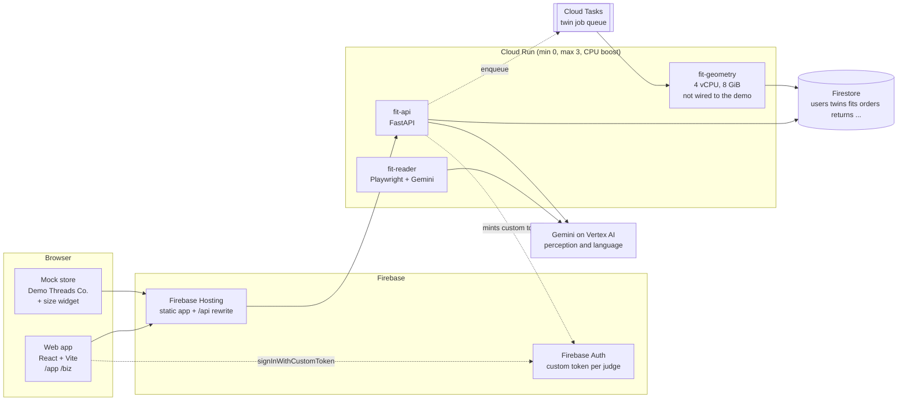

# Measured Fit

**Measured, not guessed.** We measure the body (a 3D twin from 4 photos) and the garment (one flat-lay photo next to an A4 sheet), so shoppers and businesses can trust size and fit answers. Built for the Google Cloud AI Builder Cup, Retail & Commerce.

> Status: this is a prototype. [HANDOFF.md](HANDOFF.md) lists what is built, what has only run against stand-ins, and what is missing. Read its "Not tested" section before relying on anything below. All demo data is **simulated** and labelled so in the UI.

## Judge steps (about 2 minutes)

1. Open the deployed URL (a Firebase Hosting address, `https://<project>.web.app`) in any browser, a private window is fine. No sign-in.
2. Press **Try demo**. You get your own sandbox: a simulated person, 20 closet items, 5 calendar events, 3 orders. Nobody else sees it, and it is deleted after 24 hours.
3. Follow the five steps on the page:
   1. **See your measured twin.** A 3D stand-in body and its measurements. Only you can read them.
   2. **Check a product.** Pick any of the 6 Demo Threads Co. products: recommended size, a fit heatmap on the body, per-zone verdicts, and a panel showing what the store sees (verdicts only).
   3. **Test an outfit for an event.** Try "Wedding reception" (tomorrow 19:00) or "Client meeting" (tomorrow 10:00). The closet is matched to the dress code and circle, and the fit engine checks each piece for strain when seated.
   4. **Unboxing and a gift.** See measured-on-arrival garments against the size chart and how each return was routed, then approve a friend's size request. The friend sees only a size and a confidence.
   5. **The business side.** Open the store and press "Find my size" (the pop-up asks you to approve sharing), and open the returns desk.

Nothing in these steps waits on the geometry service or a model: the twin, fits and heatmaps are precomputed by `seed/seed.py`.

## Architecture



Dotted lines are written but not exercised by the judge path. `packages/fitcore` is the shared Python library (fit engine, garment measurement, reviews, returns routing, occasion test) installed into every service.

## Google services and why

| Service | Used for | On the judge path? |
|---|---|---|
| **Cloud Run** | `fit-api` (public), `fit-reader` and `fit-geometry` (private). Min instances 0, max 3, startup CPU boost; geometry 4 vCPU, 8 GiB, 900 s. | api only |
| **Firebase Hosting** | The web app, the static store and the `.glb` files, with `/api/**` rewritten to `fit-api`. | yes |
| **Firebase Auth** | Judges sign in with a custom token minted by `POST /v1/demo/session`; real users would use Google sign-in. | yes |
| **Firestore** | All data: twins, wardrobe, events, fits, orders, returns, gifts, merchants, charts. Sandboxes carry `expire_at` and a TTL policy removes them. | yes |
| **Cloud Tasks** | Queue for twin jobs (created by `infra/setup.sh`). | no, twin jobs run inline today |
| **Cloud Storage** | Reserved for raw photos (deleted after processing) and overlays. | no |
| **Gemini on Vertex AI** (`google-genai`, `vertexai=True`) | Reading product pages, garment landmarks, return case summaries, simulation memo. Model IDs come from env vars only. | no, the judge path is deterministic |
| **Cloud Build + Artifact Registry** | Building and storing the service images. | no |
| **Cloud Billing Budgets** | Budget alert on the project (`infra/setup.sh`). | no |

The ADK planner agent and the MediaPipe/SMPL geometry pipeline are not part of the demo (see HANDOFF).

## Local setup

```bash
pip install -e packages/fitcore
pip install fastapi httpx pytest playwright pillow pyjwt google-auth firebase-admin uvicorn python-multipart numpy pyarrow
cd web && npm install && cd ..
python seed/seed.py                         # local store at services/api/.data and the .glb files in web/public/demo/glb
cd services/api && AUTH_MODE=dev API_CORS_ORIGINS=http://localhost:5173 uvicorn main:app --port 8000   # dev auth: local only
cd web && VITE_AUTH_MODE=dev npm run dev    # http://localhost:5173, press Try demo
python -m pytest packages/fitcore/tests     # run each suite on its own
python -m pytest services/api/tests
python infra/smoke_test.py http://127.0.0.1:8000 --api-prefix "" --assets-url http://localhost:5173
```

`AUTH_MODE=dev` accepts `Bearer dev:<uid>`. It is for local work only and must never be set in the cloud. Every module has a small CLI that runs on files in `samples/` without the cloud (see the folder READMEs).

## Deploy

```bash
export GOOGLE_CLOUD_PROJECT=... BILLING_ACCOUNT=...
bash infra/setup.sh                                  # registry, Cloud Tasks queue, TTL policies, roles, budget alert
cp infra/vars/api.example.yaml infra/vars/api.yaml   # same for reader and geometry; fill in model IDs and a random CONSENT_JWT_SECRET
make deploy-api deploy-reader deploy-geometry        # or: python infra/make.py deploy-api   (add DRY_RUN=1 to only print)
API_STORE=firestore python seed/seed.py --origin https://$GOOGLE_CLOUD_PROJECT.web.app --store-base https://$GOOGLE_CLOUD_PROJECT.web.app/store
make deploy-web
python infra/smoke_test.py https://$GOOGLE_CLOUD_PROJECT.web.app --firebase-api-key <web api key>
bash infra/verify_infra.sh                           # scaling, geometry size, queue, budget alert, hosting rewrite
```

- `infra/eval_day.sh` sets min instances to 1 on api and reader for evaluation days; `infra/after_eval.sh` sets them back to 0.
- `infra/pin_submitted.sh` tags the serving revisions `submitted` and pins 100% of traffic to them. After that, `infra/deploy.sh` deploys with `--no-traffic` and a tag, so judges keep seeing the submitted build.
- Seeding needs Firestore access as the signed-in `gcloud` user (`gcloud auth application-default login`).

## Privacy

- Raw body photos are deleted after processing unless the user opts in to keep the front photo. (The capture flow itself is not built yet; see HANDOFF.)
- A shopper's measurements and shape parameters are readable only by their owner (`/v1/me/*`, Firestore rules). Business-facing endpoints return verdicts only: a size, a confidence, per-zone words and a guarantee flag. A test fails if a measurement field is ever added to that response.
- Stores get a size only after the shopper approves in a pop-up, through a signed, revocable, 30-day consent token.
- A gift giver sees only a size and a confidence, and only after the recipient approves.
- Users confirm they are 18+ before body capture. Text shown to users describes the garment and never judges the body.
- Judge sandboxes are separate users with their own merchant, expire after 24 hours, and the demo endpoint is rate limited.
- All demo people, orders and measurements are simulated and labelled as such.

## Known limitations

- The "twin" in the demo is a **stand-in mannequin** sized from simulated measurements, not an SMPL fit of photos. The geometry service (MediaPipe, SMPL, critic loop) exists as code but has never run on real photos and is not part of the demo.
- The seeded persona is synthetic. Unboxing measurements and overlays are simulated; no garment photo from a real shop has been measured.
- The occasion test, product checks and heatmaps are deterministic and precomputed. They use the fit engine's `# TUNE` numbers, which are starting guesses, not calibrated values.
- One product (the silk-blend blouse) has no size that fits the persona. That is a real result of the engine, shown as such.
- Deployment scripts and the smoke test against a deployed URL have **not** been run: no Google Cloud project was available while writing them. The smoke test and the judge path ran against a local API and Vite server only.
- Rate limits are per Cloud Run instance. The demo returns desk and checkout in the store write to the shared demo merchant; only the seeded data is per judge.
- See [HANDOFF.md](HANDOFF.md) for the full lists.
